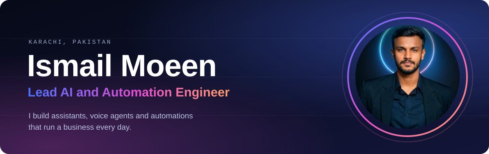
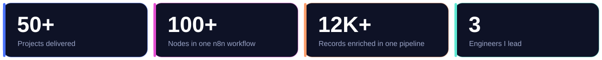

 

## Selected work

Six systems built end to end, each with a working app, tests, an n8n version and a demo video. Videos and write-ups are on my portfolio: **[ismailmoeen.dev](https://ismailmoeen.dev)**

## What I do

| Area | What it covers |
|---|---|
| **AI agents and RAG** | Assistants that answer from your own documents and act in your tools. They show their source and refuse when the documents do not say. |
| **Voice AI** | Phone agents that book appointments, answer calls and hand over to a person. |
| **Workflow automation** | Email, forms, CRMs and finance tools connected without manual steps, in n8n, Make and Python. |
| **Data pipelines** | Pipelines that clean, enrich and rank data, with checkpoints so long runs resume. |

## Experience

| Company | Role | Period |
|---|---|---|
| **1Click**, Karachi | Lead AI and Automation Engineer | Sep 2025 to present |
| **ITX Solutions**, Karachi | Lead AI Engineer | Sep 2024 to Sep 2025 |
| **Winklin**, Karachi | AI Engineer | Jun 2024 to Sep 2024 |
| **Hamdan Technologies**, Karachi | Junior AI Engineer | Aug 2023 to Jun 2024 |

Education: MS in Artificial Intelligence (in progress) and BS in Artificial Intelligence, Bahria University Karachi.

## Stack

## Get in touch

Send a short note about the problem and the tools you already use. I will reply with what I would build and what I would need to start.

**solution@ismailmoeen.dev** · [ismailmoeen.dev](https://ismailmoeen.dev) · [LinkedIn](https://www.linkedin.com/in/ismail-moeen-808000227/)
